<div align="center">



<br/>

<a href="https://git.io/typing-svg">
  
</a>

<br/>


[](https://www.linkedin.com/in/nishant-sawardekar-2974063a4)
[](mailto:nishant.sawardekar2002@gmail.com)
[](https://github.com/ish1010n/nishant-portfolio)





</div>

## `> ./pipeline --live`

<div align="center">

</div>

## `> stack --orbit`

<div align="center">


<br/>


-EE0000?style=for-the-badge&logo=ansible&logoColor=white)


-4EAA25?style=for-the-badge&logo=gnubash&logoColor=white)


</div>

## `> ls ~/projects`

<table>
  <tr>
    <td width="50%">

### 🚀 Automated Deployment System
Push code to GitHub and a **webhook triggers Jenkins**, which builds and deploys the app in **Docker** containers on **AWS EC2** behind **Nginx**, with real-time deployment tracking and ZIP download.

`Jenkins` `Docker` `AWS EC2` `Nginx` `Node.js` `Webhooks`

[**View Repo →**](https://github.com/ish1010n/automated-deployment-system)

</td>
    <td width="50%">

### 📊 AWS Monitoring & Alerting
EC2 monitoring with **CloudWatch** alarms for high CPU usage and instance health checks, plus a simple logging and monitoring routine.

`AWS EC2` `CloudWatch` `Alarms` `Logging`

</td>
  </tr>
  <tr>
    <td width="50%">

### 🌐 Personal Portfolio
My portfolio website showcasing projects, skills and experience.

`HTML` `CSS` `JavaScript`

[**View Repo →**](https://github.com/ish1010n/nishant-portfolio)

</td>
    <td width="50%">

### 🛠️ More coming soon
Kubernetes deployments and Ansible automation projects are on the way.

`Kubernetes` `Ansible`

</td>
  </tr>
</table>

## `> cat certifications.txt`

<div align="center">


</div>

## `> git stats --live`

<div align="center">


<br/>


<br/><br/>


</div>

## `> roadmap --2026`

```diff
+ [DONE]  Ubuntu server administration, SSH, user management
+ [DONE]  AWS: EC2, VPC, IAM, S3, CloudWatch
+ [DONE]  Jenkins + Bitbucket/GitHub CI/CD pipelines
+ [DONE]  Docker containerization
! [NOW]   Kubernetes, hands-on deployments
! [NOW]   Ansible and Bash automation
- [NEXT]  AWS certification (Cloud Practitioner → Solutions Architect Associate)
- [NEXT]  Terraform + monitoring with Prometheus & Grafana
```

<div align="center">


*"Automate the boring stuff. Ship the cool stuff."* ⚡


</div>
